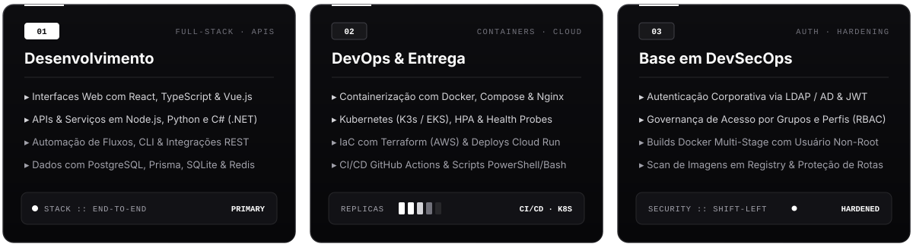

<div align="center">

<picture>
  <source media="(prefers-color-scheme: dark)" srcset="./assets/hero-dark.svg">
  <source media="(prefers-color-scheme: light)" srcset="./assets/hero-light.svg">
  
</picture>

<br/>

<a href="https://linkedin.com/in/nicolasrmoura">
  
</a>
<a href="mailto:nicolasrmoura4022@gmail.com">
  
</a>


</div>

<picture>
  <source media="(prefers-color-scheme: dark)" srcset="./assets/divider-dark.svg">
  <source media="(prefers-color-scheme: light)" srcset="./assets/divider-light.svg">
  
</picture>

### `01 // SOBRE MIM & PERFIL TÉCNICO`

Sou **Desenvolvedor Full-Stack** em São Paulo com atuação direcionada para **Desenvolvimento de Software** e **DevOps**, trazendo também uma base prática em **DevSecOps**. Gosto de acompanhar o ciclo completo da solução: construir interfaces limpas e APIs bem estruturadas, automatizar processos operacionais e estruturar deploys reproduzíveis em containers e nuvem com controle de acesso seguro.

```yaml
apiVersion: profile.nicolasmoura.dev/v1
kind: DeveloperProfile
metadata:
  name: Nicolas Rodrigues Moura
  location: Sao Paulo, SP - Brasil
spec:
  focus:
    primary: [Full-Stack Software Development, Process Automation]
    secondary: [DevOps, Containers, CI/CD, Cloud Infrastructure]
    foundation: [DevSecOps, Corporate Auth (LDAP/RBAC), Container Hardening]
  languages: [TypeScript, JavaScript, Python, C#, SQL, PowerShell, Bash]
  mindset: Clean Architecture · Reliable Delivery · Security by Default
```

<picture>
  <source media="(prefers-color-scheme: dark)" srcset="./assets/divider-dark.svg">
  <source media="(prefers-color-scheme: light)" srcset="./assets/divider-light.svg">
  
</picture>

### `02 // ÁREAS DE ATUAÇÃO`

<div align="center">
  <picture>
    <source media="(prefers-color-scheme: dark)" srcset="./assets/architecture-dark.svg">
    <source media="(prefers-color-scheme: light)" srcset="./assets/architecture-light.svg">
    
  </picture>
</div>

<picture>
  <source media="(prefers-color-scheme: dark)" srcset="./assets/divider-dark.svg">
  <source media="(prefers-color-scheme: light)" srcset="./assets/divider-light.svg">
  
</picture>

### `03 // STACK & FERRAMENTAS`

<table>
  <tr>
    <td width="235"><b>Front-End &amp; Web</b></td>
    <td>
      
      
      
      
      
      
      
    </td>
  </tr>
  <tr>
    <td><b>Back-End &amp; Dados</b></td>
    <td>
      
      
      
      
      
      
      
      
      
    </td>
  </tr>
  <tr>
    <td><b>DevOps &amp; Infraestrutura</b></td>
    <td>
      
      
      
      
      
      
      
      
      
      
      
    </td>
  </tr>
  <tr>
    <td><b>Segurança (DevSecOps)</b></td>
    <td>
      
      
      
      
      
    </td>
  </tr>
</table>

<picture>
  <source media="(prefers-color-scheme: dark)" srcset="./assets/divider-dark.svg">
  <source media="(prefers-color-scheme: light)" srcset="./assets/divider-light.svg">
  
</picture>

### `04 // PROJETOS PÚBLICOS & EXPERIÊNCIA PRÁTICA`

<table>
  <tr>
    <td width="50%" valign="top">
      <h4><code>[PUBLIC]</code> <a href="https://github.com/Nicolas-RMoura/lead-automation-system">Lead Automation System</a></h4>
      <p>Aplicação web construída em <b>Python (Flask)</b>, <b>SQLite</b> e <b>HTML/CSS</b> para captura, validação e persistência de leads via formulário integrado, disparando rotinas automatizadas de processamento.</p>
    </td>
    <td width="50%" valign="top">
      <h4><code>[PUBLIC]</code> <a href="https://github.com/Nicolas-RMoura/meu-portfolio">Portfólio Full-Stack</a></h4>
      <p>Página autoral responsiva desenvolvida em <b>HTML5, CSS3 e JavaScript</b> com suporte nativo a temas claro e escuro, vitrine de projetos web e canais diretos de contato.</p>
    </td>
  </tr>
  <tr>
    <td width="50%" valign="top">
      <h4><code>[CORP · DEV]</code> Plataformas Internas &amp; Automações</h4>
      <p>Desenvolvimento full-stack de portais corporativos, ferramentas CLI de automação fiscal/documental, agentes de monitoramento de hardware em <b>C# (.NET)</b> e pipelines de sincronização entre design systems e APIs em <b>TypeScript, Node.js, React e Python</b>.</p>
    </td>
    <td width="50%" valign="top">
      <h4><code>[DEVOPS · SEC]</code> Containers, Orquestração &amp; Acesso</h4>
      <p>Padronização de ambientes com <b>Docker</b> e <b>Nginx</b>, scripts de deploy automatizado em <b>PowerShell/Bash</b>, pipelines <b>GitHub Actions</b>, orquestração <b>Kubernetes (HPA, Probes e Rolling Updates)</b> com IaC em <b>Terraform</b>, além de autenticação <b>LDAP/AD com RBAC</b> e containers <code>non-root</code>.</p>
    </td>
  </tr>
</table>

<picture>
  <source media="(prefers-color-scheme: dark)" srcset="./assets/divider-dark.svg">
  <source media="(prefers-color-scheme: light)" srcset="./assets/divider-light.svg">
  
</picture>

### `05 // ATIVIDADE DE CONTRIBUIÇÕES`

<div align="center">
  <picture>
    <source media="(prefers-color-scheme: dark)" srcset="https://raw.githubusercontent.com/Nicolas-RMoura/Nicolas-RMoura/output/snake-dark.svg">
    <source media="(prefers-color-scheme: light)" srcset="https://raw.githubusercontent.com/Nicolas-RMoura/Nicolas-RMoura/output/snake-light.svg">
    
  </picture>
</div>

<br/>

<div align="center">
  <picture>
    <source media="(prefers-color-scheme: dark)" srcset="./assets/footer-dark.svg">
    <source media="(prefers-color-scheme: light)" srcset="./assets/footer-light.svg">
    
  </picture>
</div>
